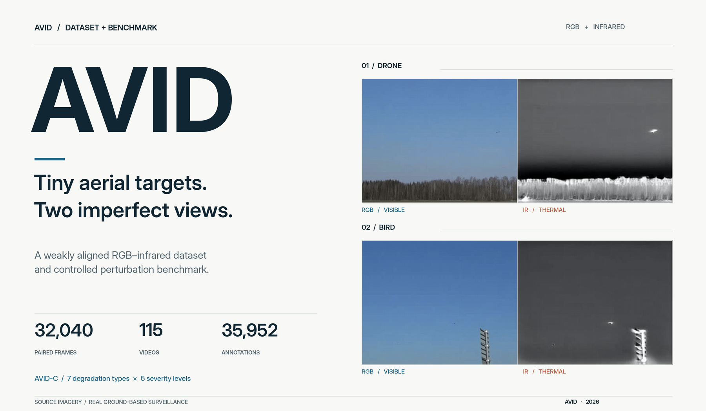
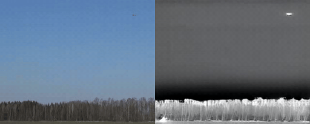
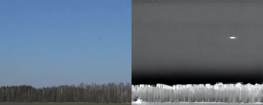
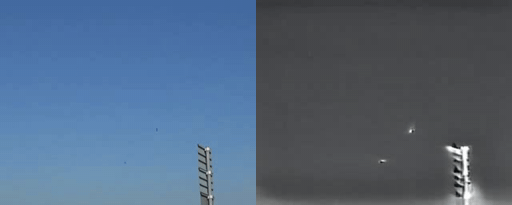
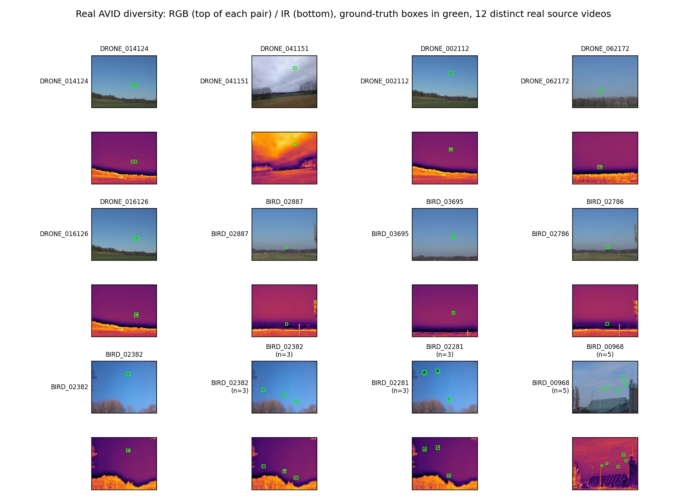
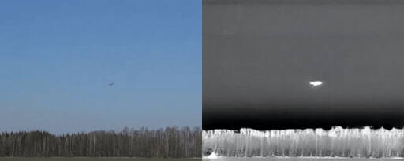
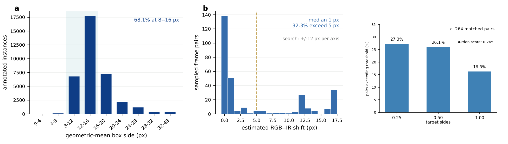
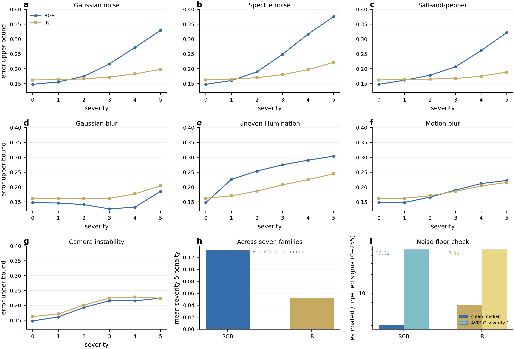
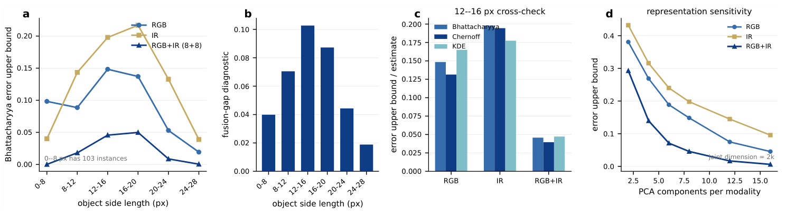

<h1 align="center">AVID: A Weakly Aligned RGB-Infrared Dataset and Perturbation Benchmark for Tiny Aerial Targets</h1>

<p align="center">
  <a href="paper/main.pdf"></a>
  <a href="https://huggingface.co/datasets/Dharini24/AVID"></a>
  <a href="https://rdharini2001.github.io/ICIP_2025_Data_Release/"></a>
  <a href="LICENSE"></a>
</p>

<p align="center">
  
</p>
<p align="center"><sub>Real paired surveillance imagery · RGB and infrared views are corresponding but not necessarily pixel-aligned</sub></p>

> **A small target, two different views.** A bird and a drone may look almost identical when each occupies only a few pixels. RGB and infrared cameras can offer complementary information, but the two views may be displaced and each can degrade differently. **How can we study these effects separately instead of hiding them behind one overall score?**

**AVID** makes the bird-drone surveillance subset curated for the **IEEE ICIP 2025 Video and Image Processing Cup** available as corresponding RGB-infrared pairs. **AVID-C** adds seven types of *simulated image degradation*, each at five severity levels, applied to RGB, infrared, or both. The paper also introduces object-relative alignment measurements and examines bird-drone class separation under a fixed feature representation. **The statistical bounds are not detector accuracy measurements.**

<p align="center"><a href="paper/main.pdf"><strong>Read the paper</strong></a> &nbsp;·&nbsp; <a href="https://huggingface.co/datasets/Dharini24/AVID"><strong>Download AVID</strong></a> &nbsp;·&nbsp; <a href="https://rdharini2001.github.io/ICIP_2025_Data_Release/"><strong>Explore the research website</strong></a> &nbsp;·&nbsp; <a href="#reproduce-the-paper"><strong>Reproduce results</strong></a></p>

---

## At a glance

<div align="center">
<table>
<tr><th>32,040</th><th>115</th><th>35,952</th><th>68.1%</th></tr>
<tr><td align="center">RGB–IR frame pairs</td><td align="center">surveillance videos</td><td align="center">bird and drone boxes</td><td align="center">8–16 px targets</td></tr>
</table>
</div>

| Dataset split | RGB–IR pairs | Videos | Bird instances | Drone instances | Total instances |
|:---|---:|---:|---:|---:|---:|
| Train | 28,790 | 102 | 14,113 | 18,335 | 32,448 |
| Validation | 3,250 | 13 | 1,358 | 2,146 | 3,504 |
| **Total** | **32,040** | **115** | **15,471** | **20,481** | **35,952** |

The original frames are **320 × 256 px**. **99.0%** of annotated targets fall within COCO's *small* category. Frame pairs refer to corresponding scene observations, **not ground-truth pixel registration**. The source Test split is not included because dependable RGB/infrared frame matching could not be established from the available records.

## See the data

<p align="center"></p>
<p align="center"><sub>A drone sequence in motion: visible on the left, infrared on the right.</sub></p>

<div align="center">
<table>
<tr><td align="center"><b>Drone sequence 02</b><br/></td><td align="center"><b>Drone sequence 03</b><br/></td></tr>
<tr><td align="center"><b>Bird sequence</b><br/></td><td align="center"><b>More examples</b><br/><a href="paper/figures/fig_diversity_montage.png"></a></td></tr>
</table>
</div>

<sub>All sequences are actual paired surveillance observations. The AVID-C perturbations described below are simulated; the source videos are not synthetic.</sub>

<details>
<summary><b>View the additional original still frames</b></summary>
<p align="center"> </p>
<p align="center"><sub>The two still-image uploads were PNG files despite having .gif filenames; they have been stored with the correct .png extension. The gallery above uses the existing animated sequences.</sub></p>
</details>


## Paper & authors

**AVID: A Weakly Aligned RGB-Infrared Dataset and Perturbation Benchmark for Tiny Aerial Targets**  
**Dharini Raghavan\*** · **Vishnu Rao\*** · **Sethu Selvi S**  
Georgia Institute of Technology · ARTPARK, Indian Institute of Science · Ramaiah Institute of Technology  
\* Equal contribution and shared first authorship.

[**Paper PDF**](paper/main.pdf) · [**LaTeX source**](paper/main.tex) · [**Bibliography**](paper/references.bib) · [**Results audit**](VERIFICATION_REPORT.md)

> [!NOTE]
> **Publication update:** The final three-author manuscript is included in this repository. An arXiv identifier and paper DOI are **not yet included**. The citation below is temporary and can be replaced when official identifiers are available.

## What AVID makes possible

| **01 · Target scale** | **02 · Weak alignment** |
|:---|:---|
| Nearly every annotated object is COCO-small. The 12–16 px interval alone contains **17,706 instances**. | Among **300 sampled pairs**, **32.3%** have an estimated shift greater than 5 px. Among **264 annotation-matched pairs**, **16.3%** exceed one median target side. |
| **03 · Simulated perturbations** | **04 · Class separation** |
| AVID-C applies seven transformations at five strengths, separately to RGB, infrared, or both. | At 12–16 px, fitted Bhattacharyya bounds are **0.148 RGB**, **0.198 IR**, and **0.046 RGB+IR (8+8 PCA)**. These are **not detection error rates**. |

<p align="center"><a href="paper/figures/fig_dataset_statistics.png"></a></p>
<p align="center"><sub>Distribution of target sizes, estimated pixel shifts, and target-relative alignment burden (0.265 among the 264 annotation-matched pairs).</sub></p>

### AVID-C: controlled image degradation

| Noise | Blur | Other effects |
|:---|:---|:---|
| Gaussian · Speckle · Salt-and-pepper | Gaussian blur · Motion blur | Uneven illumination · Camera instability |

Each type has **five severity levels**. To make comparisons informative, report the **perturbation type, severity, and affected modality**, not only an average.

<p align="center"><a href="paper/figures/fig_corruption_analysis.png"></a></p>

### An illustrative fixed-feature finding

<p align="center"><a href="paper/figures/fig_scale_analysis.png"></a></p>

The paired features have a lower fitted overlap bound at common target sizes in the chosen PCA representation. **Feature dimension matters**: the equal-dimensional 4+4 RGB/IR result is **0.140**, much closer to the RGB-only **0.148**. Added infrared shifts reduce the fitted fusion-gap retention to **0.844** for a **12-px per-axis shift budget**. These are not results from a trained full-frame detector.

## Download AVID

All full-resolution paired images and labels are hosted on **[Hugging Face](https://huggingface.co/datasets/Dharini24/AVID)**, not in this Git repository.

```bash
pip install --upgrade "huggingface_hub[cli]"
hf download Dharini24/AVID --repo-type dataset --local-dir ./AVID
```

The provided YOLO-style labels use `0 = bird` and `1 = drone`. Preserve **video-level splits** to avoid frame leakage between training and evaluation. See the [dataset schema and preparation notes](dataset_tools/hf_release/SCHEMA.md) for file conventions.

<details>
<summary><b>Repository map</b></summary>

```text
paper/                     final paper PDF, LaTeX, figures, and analysis scripts
assets/showcase/           animated RGB/IR examples and cover image
dataset_tools/             curation, AVID-C, alignment, and fixed-feature analyses
reproducibility_data/      CSVs used for the paper's reported numbers
docs/                      research website (GitHub Pages)
release_notes/             Hugging Face card and publication instructions
VERIFICATION_REPORT.md     scope of the 59 numerical checks
DATA_PROVENANCE_AND_LICENSING.md
```

</details>

## Reproduce the paper

The repository contains the **summary and per-sample CSV exports behind the manuscript's numerical results**. The audit checked those values against the final manuscript; it did **not** independently recompute every measurement from the full image corpus.

```bash
python paper/audit/verify_final_csvs.py
python -m pytest -q dataset_tools/alignment/test_alignment_metrics.py dataset_tools/corruptions/test_corruptions.py
```

[Data-to-number mapping](reproducibility_data/README.md) · [Paper build instructions](paper/README.md) · [Verification scope](VERIFICATION_REPORT.md) · [Release guide](release_notes/HOW_TO_PUBLISH.md)

## Citation

Please cite **both** AVID and the original Drone Detection Dataset. Until the AVID manuscript receives an arXiv ID or DOI, use:

```bibtex
@misc{raghavan2026avid,
  title  = {AVID: A Weakly Aligned RGB-Infrared Dataset and Perturbation Benchmark for Tiny Aerial Targets},
  author = {Raghavan, Dharini and Rao, Vishnu and S, Sethu Selvi},
  year   = {2026},
  note   = {Manuscript and dataset release; arXiv ID and DOI pending},
  url    = {https://github.com/rdharini2001/ICIP_2025_Data_Release}
}
```

**Original data:** Svanström, F., Alonso-Fernandez, F., and Englund, C. (2021). *A Dataset for Multi-Sensor Drone Detection*. *Data in Brief*, 39, 107521. [DOI: 10.1016/j.dib.2021.107521](https://doi.org/10.1016/j.dib.2021.107521).

## Provenance, licensing & responsible use

The underlying videos and images were collected and shared by **Svanström, Alonso-Fernandez, and Englund** through the [original Drone Detection Dataset](https://github.com/DroneDetectionThesis/Drone-detection-dataset) under **CC0 1.0 Universal**. The released AVID dataset *package* is listed on Hugging Face as **CC BY-NC 4.0**; that label does not remove the original CC0 status of the underlying source imagery. The code in this repository uses the **MIT license**.

AVID is intended for research on tiny aerial targets, pairing, image degradation and sensor fusion. It does not contain person-identity labels. Real-world deployment requires separate evaluation and consideration of legal and safety risks. See [data provenance and licensing](DATA_PROVENANCE_AND_LICENSING.md) and the limitations in the [paper](paper/main.pdf).

<p align="center"><sub>Prepared from the IEEE ICIP 2025 Video and Image Processing Cup bird-drone curation · Maintained as a reproducible research resource</sub></p>
