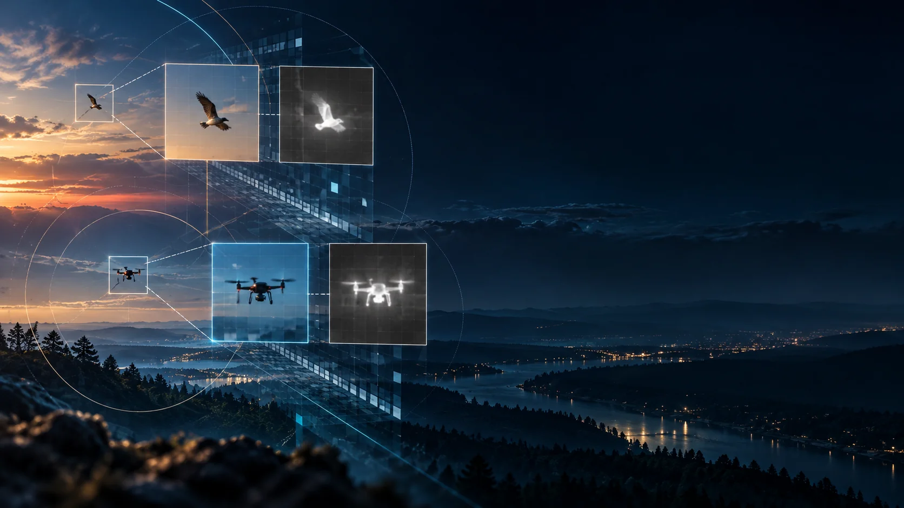

<h1 align="center">AVID: A Weakly Aligned RGB–Infrared Dataset and<br/>Perturbation Benchmark for Tiny Aerial Targets</h1>

<div align="center">


[](https://github.com/rdharini2001/ICIP_2025_Data_Release/stargazers)
[](LICENSE)

</div>

<p align="center"><a href="https://rdharini2001.github.io/ICIP_2025_Data_Release/"></a></p>

<p align="center"><a href="https://rdharini2001.github.io/ICIP_2025_Data_Release/"><b>Research website ↗</b></a> · <a href="paper/main.pdf"><b>Paper PDF ↗</b></a> · <a href="paper/main.tex"><b>LaTeX source ↗</b></a> · <a href="https://huggingface.co/datasets/Dharini24/AVID"><b>Hugging Face dataset ↗</b></a></p>

*Ground-based counter-drone surveillance needs to tell a 12-pixel drone apart from a 12-pixel bird, using two cameras that are not pixel-registered. Most RGB-thermal benchmarks assume co-located, calibrated rigs and never have to answer that question. We ask:* **what does a real, weakly-aligned, extreme-small-object RGB-IR corpus actually look like, and how much does weak alignment cost a fusion system — provably, not just empirically?**

We present **AVID**, a paired RGB-infrared dataset and perturbation benchmark where the detection target is the drone itself (not the camera platform), together with a classifier-agnostic benchmark that measures scale, corruption, and alignment sensitivity directly from the data distribution — no detector is trained anywhere in the paper. AVID has **32,040** real RGB-IR pairs from **115** videos, **35,952** bird/drone instances, and a reproducible **7×5** corruption suite (**AVID-C**).

> [!NOTE]
> **AVID is released on Hugging Face.** Real, deduplicated RGB-IR pairs, YOLO-format labels, and the full reproducibility package (every CSV behind every number in the paper).
>
> [](https://huggingface.co/datasets/Dharini24/AVID)

## Paper

<b>AVID: A Weakly Aligned RGB-Infrared Dataset and Perturbation Benchmark for Tiny Aerial Targets</b><br/>
Dharini Raghavan¹, Vishnu Rao²<br/>
*¹Georgia Institute of Technology, ²ARTPARK, Indian Institute of Science*<br/>
<a href='paper/main.pdf'></a>
<a href='https://huggingface.co/datasets/Dharini24/AVID'></a>

## AVID Dataset

### Four lines of code to download

```bash
python -m pip install --upgrade "huggingface_hub[cli]"
mkdir AVID && cd AVID
hf download Dharini24/AVID --repo-type dataset --local-dir .
```

| | Train | Validation | Total |
|---|---:|---:|---:|
| RGB-IR pairs | 28,790 | 3,250 | **32,040** |
| videos | 102 | 13 | **115** |
| bird / drone instances | 14,113 / 18,335 | 1,358 / 2,146 | **15,471 / 20,481** |

- **Extreme small-object regime**: 68.1% of all 35,952 boxes are 8–16px (geometric-mean side) in a 320×256 frame; zero boxes exceed 48px.
- **Weakly aligned, quantified, not assumed**: RGB and IR come from physically separate optics. On a real 300-pair sample, 32.3% of pairs exceed 5px of measured shift — and an object-relative ratio ρ = shift/target-size shows 16.3% of the 264 annotation-matched pairs have shift *larger than the target itself*.
- **AVID-C**: 7 corruption families (Gaussian/speckle/salt-and-pepper noise, Gaussian blur, uneven illumination, motion blur, camera instability) × 5 severities, released as deterministic, seeded code — not fixed pre-rendered files.

Full dataset card, known issues, and licensing terms: [Hugging Face dataset page](https://huggingface.co/datasets/Dharini24/AVID).

## Benchmark highlights

Every number below is computed directly from the data distribution (closed-form Bhattacharyya/Chernoff bounds, a nonparametric KDE cross-check, mutual information) — **no detector is trained anywhere in the paper.**

| Diagnostic | Finding |
|---|---|
| Fusion vs. single modality (modal 12-16px scale) | Bayes error bound: RGB 0.148, IR 0.198, **Fusion 0.046** (3-4× lower) |
| Bound tightening | Optimized Chernoff bound 6-13% tighter than the Bhattacharyya default; KDE cross-check agrees within 11-16% |
| Corruption asymmetry | Under noise-type corruption, RGB's separability bound roughly triples; IR barely moves |
| Alignment cost | Bayes Fusion Gain shrinks 16% as injected misalignment reaches the real measured ceiling (17px) — but never vanishes |
| "Clean" baseline validity | Real intrinsic noise floor is 7-12× (up to 2 orders of magnitude) smaller than AVID-C's smallest injected severity |

Full reproducibility package (every CSV behind every number above): [`reproducibility_data/`](reproducibility_data/).

## Repository structure

```
.
├── paper/                 # arXiv-ready paper (main.tex, main.pdf, figures/)
├── reproducibility_data/  # CSV export of every number in the paper, + README mapping each to its source script
├── dataset_tools/
│   ├── theory/            # the Bayes-risk benchmark: patch extraction, scale/corruption/alignment sweeps,
│   │                       Chernoff/KDE tightness cross-checks, CSV exporter
│   ├── corruptions/       # AVID-C: the reproducible 7x5 corruption suite + real-data noise-floor validation
│   ├── alignment/         # per-pair weak-alignment estimators (phase correlation + mutual-information search)
│   └── hf_release/        # corpus stats, object-relative misalignment ratio, dataset build/upload scripts,
│                           Hugging Face dataset card + schema
├── docs/RELEASE_RUNBOOK.md  # step-by-step checklist: regenerate -> recompile -> upload -> submit
└── archive/                 # historical planning notes, kept for provenance
```

<details>
<summary><b>Regenerate every number in the paper from scratch</b></summary>

```bash
python -m dataset_tools.theory.patch_extraction
python -m dataset_tools.theory.scale_sweep
python -m dataset_tools.theory.corruption_sweep
python -m dataset_tools.theory.alignment_sweep
python -m dataset_tools.theory.real_cross_checks
python -m dataset_tools.corruptions.noise_floor_check
python -m dataset_tools.hf_release.object_relative_misalignment
python dataset_tools/theory/export_reproducibility_csvs.py
```

Full details, including recompiling the paper and the Hugging Face upload step, in [`docs/RELEASE_RUNBOOK.md`](docs/RELEASE_RUNBOOK.md).

</details>

<details>
<summary><b>What's real vs. what's disclosed as a limitation</b></summary>

Every number in the paper is computed directly on the real, deduplicated corpus — there is no untrained-placeholder or synthetic-data result presented as final anywhere. Real findings from release preparation, disclosed rather than papered over:

- The source export had a 100%-of-frames noise-augmentation duplicate, identified and removed.
- The true class-index mapping is `0=bird, 1=drone`, not the reverse.
- The source Test split's RGB and IR files cannot currently be paired by any available key — excluded from the paired release rather than force-matched.
- Naive frame-level splitting leaks 87.5% of nominally held-out frames (vs. 0.0% for the video-level splitting this release uses).

</details>

## Interactive research website

The `docs/` directory contains the AVID research atlas: synchronized RGB/IR recordings, downloadable paired GIFs, interactive object-relative alignment burden, seven-family AVID-C severity plots, fusion sensitivity, and access to the paper. No backend is required. The numerical reconciliations are explained in [the provenance audit](docs/METRIC_PROVENANCE.md). See [publishing instructions](docs/PUBLISH.md) for GitHub Pages.

## Citation

```bibtex
@misc{avid2026,
  title  = {AVID: A Weakly Aligned RGB-Infrared Dataset and Perturbation Benchmark for Tiny Aerial Targets},
  author = {Raghavan, Dharini and Rao, Vishnu},
  year   = {2026},
  note   = {Dataset and preprint; see https://github.com/rdharini2001/ICIP_2025_Data_Release}
}
```

## Acknowledgements

AVID builds on the dataset construction effort for the IEEE ICIP 2025 VIP Cup, "Infrared-Visual Fusion for Enhanced Drone Detection, Tracking and Payload Identification in Surveillance Videos," organized by S. Sethu Selvi, Raghuram S, Sitaram Ramachandrula, Vishnu Rao, Dharini Raghavan, Shefali Singh, Sangeeta Kar, and Suman Jangid (Ramaiah Institute of Technology / Indian Institute of Science / [24]7.ai).

## License

Code in this repository is released under the [MIT License](LICENSE). The **dataset itself** (hosted on Hugging Face) is released separately under **CC BY-NC 4.0** — see the [Hugging Face dataset card](https://huggingface.co/datasets/Dharini24/AVID) for full terms.
